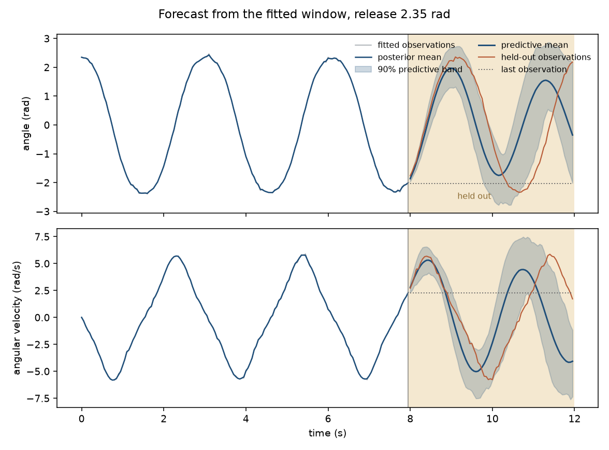
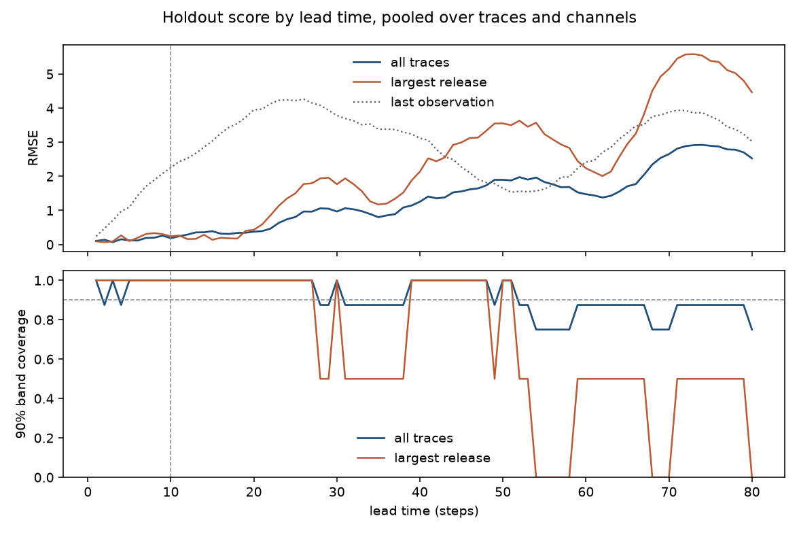
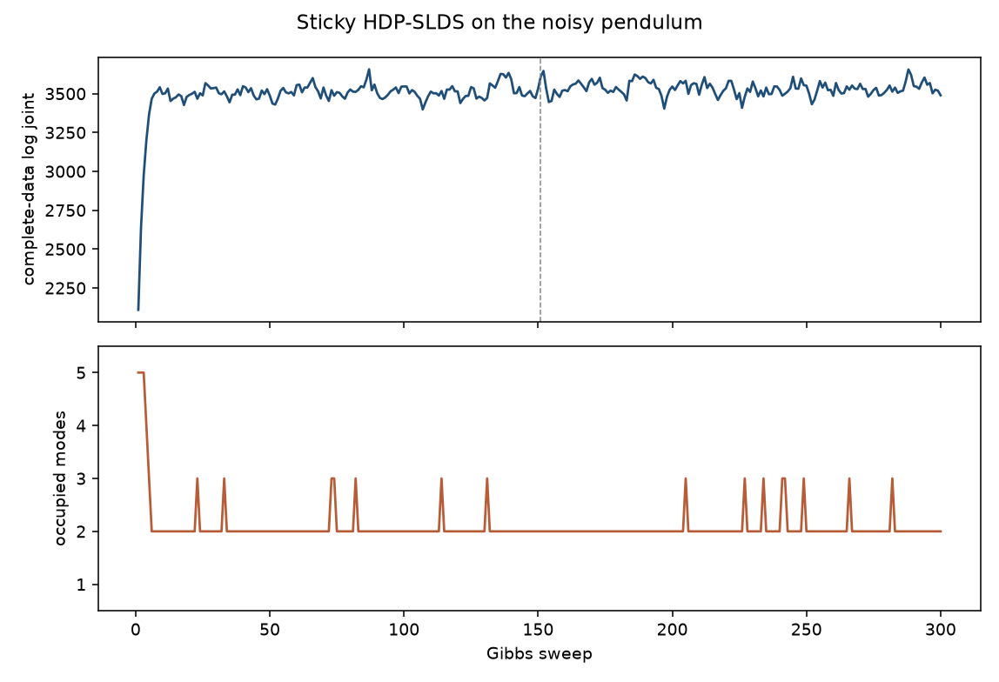
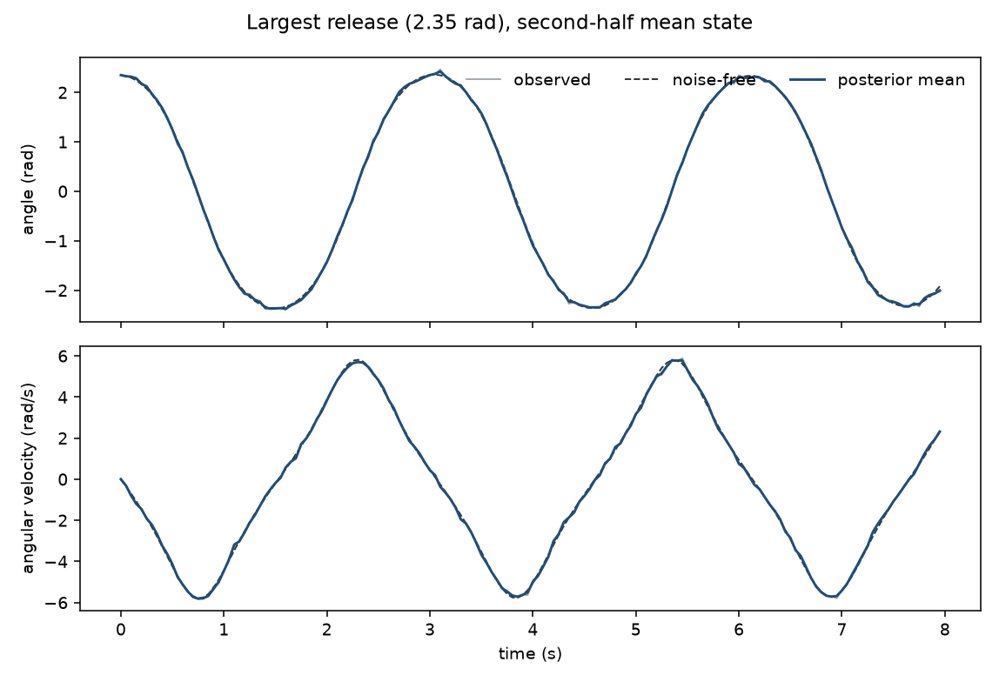
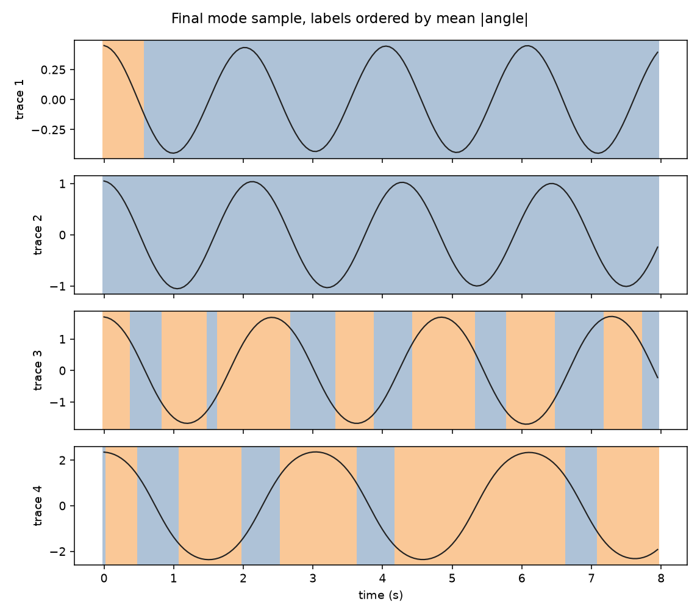

# Sticky HDP-SLDS

Gibbs sampling for a sticky hierarchical Dirichlet process switching linear dynamical system, following Fox, Sudderth, Jordan, and Willsky, [Bayesian Nonparametric Inference of Switching Linear Dynamical Systems](https://arxiv.org/abs/1003.3829). The sampler is JAX. The result below is an 80-step forecast of a noisy pendulum that the sampler never sees.

## Forecast





`examples/pendulum_forecast.py` fits the training series with the blocked sampler (seed 11, 300 sweeps, sequential mode updates off) and scores 150 futures from sweeps 151–300. The chain starts at the prior means. Pooled over four traces and both channels, the predictive mean has RMSE 0.162 on the first 10 steps and 1.553 over all 80. The central 90% band covers 97.5% of the first 10 steps and 92.0% of the horizon. Repeating the last observation scores 1.446 and 3.032 on those same windows. An earlier sequential sampler of this holdout scored RMSE 1.456 and 94.5% coverage over the 80 steps.

The 2.35 rad release is the trace in the figure. Its 90% band covers 69.4% of the horizon and 40% of the last 20-step block. The three smaller releases have horizon coverage 99.4%, 99.4%, and 100%.

## Volatility


`examples/regime_volatility.py` scores the log of the mean squared return over the next 1, 5, 20, and 60 days, at every holdout origin. The S&P 500 holdout is the last 250 trading days. Bitcoin's is the last 365 calendar days. The regime model is a 3-state sticky HAR on daily `log(r^2)`, refit every 21 origins on a trailing 4-year window. Each refit is 4 chains of 2000 sweeps, seed 23, with 160 thinned draws. The scored forecast is a direct regression at each horizon, with a separate intercept and HAR slopes in each regime, weighted by the filtered probabilities after they are moved forward with the transition matrix. A bias correction uses only windows that have already ended. Baselines are HAR(1/5/22), the expanding mean of the target, EWMA 0.94, and GARCH(1,1) Student-t. Each baseline uses only data before the target window. Diebold-Mariano tests use a Newey-West variance with lag `h - 1`. A negative statistic means the regime model has the smaller squared error. The same tests are on the [volatility page](https://kosmitive.github.io/sticky-hdp-slds-hmm/volatility/).

The close files are in `examples/data/`: Yahoo Finance chart API daily closes, interval 1d, downloaded 2026-10-11. The S&P file keeps the 2001-09-10 to 2001-09-17 market closure. The Bitcoin file drops 2026-10-11, the download date. See `examples/data/README.md`.

S&P 500. Twelve refits, worst R-hat 1.023, 41.2 s. The long-run mean wins every horizon. Direct is this run. Simulated is the previous path forecast and was not re-estimated.

| Lead (days) | Direct | Simulated | HAR | EWMA 0.94 | GARCH-t | Mean |
| --- | ---: | ---: | ---: | ---: | ---: | ---: |
| 1 | 2.708 | 2.750 | 2.706 | 3.097 | 3.152 | 2.696 |
| 5 | 0.855 | 0.891 | 0.820 | 0.856 | 0.901 | 0.807 |
| 20 | 0.567 | 0.850 | 0.549 | 0.568 | 0.618 | 0.480 |
| 60 | 0.393 | 0.992 | 0.419 | 0.450 | 0.516 | 0.307 |

| Lead (days) | vs HAR | vs mean | vs EWMA | vs GARCH |
| --- | ---: | ---: | ---: | ---: |
| 1 | 0.14 (0.887) | 0.61 (0.540) | -4.61 (4.0e-6) | -4.89 (1.0e-6) |
| 5 | 1.08 (0.280) | 1.21 (0.227) | -0.05 (0.959) | -1.18 (0.239) |
| 20 | 0.50 (0.618) | 2.39 (0.017) | -0.01 (0.989) | -1.26 (0.209) |
| 60 | -0.86 (0.388) | 1.89 (0.059) | -1.18 (0.238) | -1.57 (0.115) |

Bitcoin. Eighteen refits, worst R-hat 1.068, 76.1 s. GARCH missed 9 origins. The direct forecast has the lowest RMSE at 20 and 60 days.

| Lead (days) | Direct | Simulated | HAR | EWMA 0.94 | GARCH-t | Mean |
| --- | ---: | ---: | ---: | ---: | ---: | ---: |
| 1 | 2.638 | 2.673 | 2.610 | 3.133 | 3.323 | 2.691 |
| 5 | 1.021 | 1.109 | 1.022 | 1.121 | 1.274 | 1.162 |
| 20 | 0.742 | 0.998 | 0.797 | 0.849 | 0.985 | 0.900 |
| 60 | 0.597 | 0.983 | 0.718 | 0.791 | 1.074 | 0.785 |

| Lead (days) | vs HAR | vs mean | vs EWMA | vs GARCH |
| --- | ---: | ---: | ---: | ---: |
| 1 | 1.23 (0.217) | -1.43 (0.153) | -6.19 (5.9e-10) | -7.22 (5.3e-13) |
| 5 | -0.03 (0.978) | -2.47 (0.013) | -2.11 (0.035) | -3.58 (3.5e-4) |
| 20 | -1.55 (0.121) | -1.97 (0.049) | -1.52 (0.130) | -3.52 (4.3e-4) |
| 60 | -1.78 (0.075) | -1.46 (0.145) | -1.43 (0.153) | -3.46 (5.3e-4) |

On the S&P 500 every comparison against HAR has a p-value above 0.27, and the direct model beats one-day EWMA and GARCH. On bitcoin it beats the mean at 5 and 20 days and GARCH at every horizon. Every comparison against HAR has a p-value above 0.05. The simulated path was biased high by about 0.65 and 0.93 on the S&P 500 at 20 and 60 days, and by about 0.63 and 0.81 on bitcoin. The direct forecast's mean errors on those leads are 0.10 and 0.15, and 0.21 and 0.22.

The removed NumPy Gibbs sampler, on the same 4-by-2000 protocol, took 312.5 s on the S&P 500 and 651.1 s on bitcoin. On one 1460-day Bitcoin window it ran at 253.3 sweeps per second; the JAX sampler runs at 1602.8, about 6.33 times that rate, with compilation excluded.

An earlier single-origin sticky HDP-SLDS, scored on overlapping realized volatility, is not in this package. On that score EWMA won the longer S&P leads, and the SLDS won Bitcoin leads 20 and 60.

Documentation: [https://kosmitive.github.io/sticky-hdp-slds-hmm/](https://kosmitive.github.io/sticky-hdp-slds-hmm/).

The sweep used for the pendulum figures is the blocked sampler: latent states, the mode sequence, the sticky HDP, the dynamics, and the emission covariance. `sequential_modes=True` adds the single-site mode update. `ard=True` replaces the matrix-normal dynamics update. The pendulum fit uses neither.

## Quick start

[uv](https://docs.astral.sh/uv/) installs the locked environment. Python 3.11 or newer is required.

```bash
uv sync
uv run pytest
uv run python -m examples.smoke_slds
uv run pre-commit install
```

`uv sync` installs `sticky_hdp_slds` and the `dev` group (pytest, ruff, pre-commit, and the `examples` group). The `examples` group provides `arch` and `matplotlib`, which are also the `volatility` and `plots` extras. Add the docs group when you want the site:

```bash
uv sync --group docs
uv run mkdocs serve
```

The smoke script builds a two-mode system in two latent dimensions, simulates two sequences of length 12, and runs three blocked Gibbs sweeps. A successful run prints a finite log joint, matching latent and observation shapes, transition rows that sum to one, and a self-transition weight `rho` in `(0, 1)`.

## Layout

| Path | Role |
| --- | --- |
| `src/sticky_hdp_slds/` | Installable package: Gibbs samplers and the volatility study |
| `examples/smoke_slds.py` | Short end-to-end run |
| `examples/pendulum_demo.py` | Noisy pendulum fit, with the figures below |
| `examples/pendulum_forecast.py` | 80-step forecast, the figures above |
| `examples/regime_volatility.py` | Rolling-origin sticky regime HAR |
| `examples/data/` | S&P 500 and Bitcoin close snapshots |
| `tests/` | Unit checks and stored-reference regressions |
| `docs/` | This site's source |

## Results

### Noisy pendulum

```bash
uv run python -m examples.pendulum_demo
```

The script integrates a nonlinear pendulum with the symplectic Euler method (`g/l = 9.81`) and fits the sticky HDP-SLDS. Four traces are released from rest at 0.45, 1.05, 1.70, and 2.35 rad. Each trace has 160 steps of `dt = 0.05` s. The observations are the angle and the angular velocity, with standard deviations 0.04 and 0.12, and the velocity also receives a process disturbance of standard deviation 0.01. The emission matrix is the identity, so piecewise-linear modes are asked to track the angle dependence of `sin(theta)`.

The truncation is 5 modes. Prior means are `alpha + kappa = 12`, `rho = 0.92`, and `gamma = 1.5`. The matrix-normal mean is the small-angle map of the same integrator, with column precision `40 I`. Those scales belong to this series. A different length, noise level, or sampling rate needs its own prior.

The figures are the blocked sampler: seed 11, 300 sweeps, sequential mode updates off, 6.6 s. The complete-data log joint starts at 2109 and ends at 3489. The four quarter means are 3462, 3516, 3540, and 3529. Over sweeps 151–300 the mean is 3534, the standard deviation is 43, and the least-squares slope is -0.07 per sweep. The last sample uses 2 modes. The second-half average is 2.05, and the chain sometimes occupies all 5.

The last sample splits the swing into two sticky regimes. The mode whose mean absolute angle is 0.614 has restoring entry `A_{2,1} = -0.424` and a mean dwell of 30.6 steps. The small-angle integrator has `A_{2,1} = -dt * g/l = -0.491`. The mode whose mean absolute angle is 1.877 has `A_{2,1} = -0.217` and a mean dwell of 9.4 steps. The posterior mean of the latent state over the second half of the chain has RMSE 0.056 against the noise-free trajectory. The raw observations have RMSE 0.089.







### Forecast

```bash
uv run python -m examples.pendulum_forecast
```

The forecast uses the same training series, seed, and hyperparameters as the fit. Eighty further steps are integrated with continuation seed 12 and are never shown to the sampler. The chain is 300 blocked sweeps and the sampler took 6.8 s. Sweeps 151–300 each contribute one future. The headline scores and both figures are at the top of this page.

Angle and angular velocity coverage over the full horizon are 91.9% and 92.2%. The three smaller releases have holdout RMSE 0.419, 0.578, and 1.064, with coverage 99.4%, 99.4%, and 100%. The largest release, 2.35 rad, has RMSE 0.223 on the first 10 steps (coverage 100%) and RMSE 2.830 over the horizon (coverage 69.4%). In 20-step blocks its RMSE is 0.241, 1.574, 3.084, and 4.471, and the band coverage is 100%, 75%, 62.5%, and 40%. The prior was not adjusted to the holdout.

The chain mixes inside a band; it does not freeze. The forecast on the 2.35 rad release is the case where a linear mode fitted on the observed swing does not carry the trajectory for the full extra horizon.

## Tests

`uv run pytest` runs the checks in `tests/`. The fast tests cover filter normalization, a three-step filter against exact enumeration, a forced backward sample, conjugate Gaussian and inverse-Wishart moments, the ARD normal equations, and the Schur-Cohn test against companion eigenvalues. The slower tests compare the rolling-origin RMSE, the Bitcoin-window posterior means, and the pendulum forecast with the stored values in `tests/fixtures/published.json`.

## License

MIT. See [LICENSE](LICENSE).
