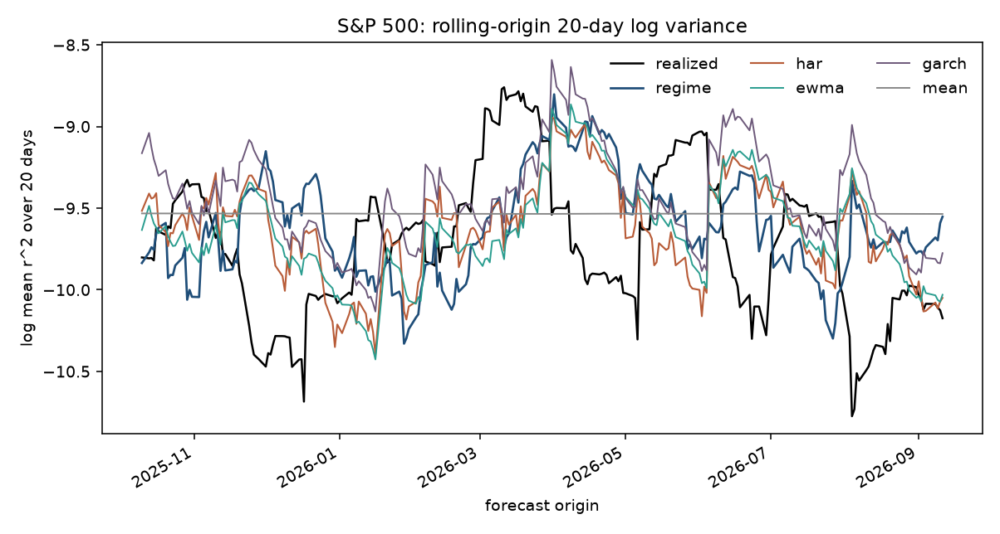
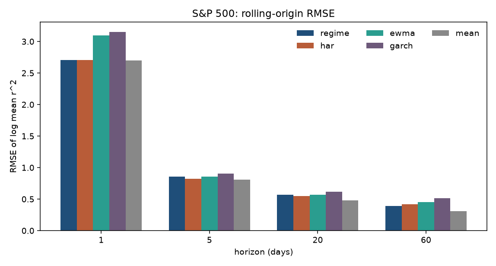
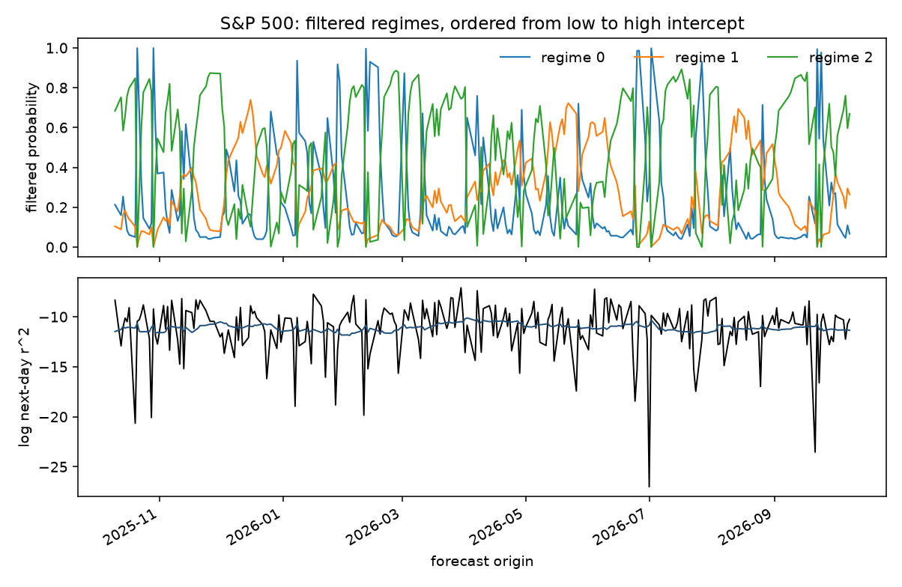
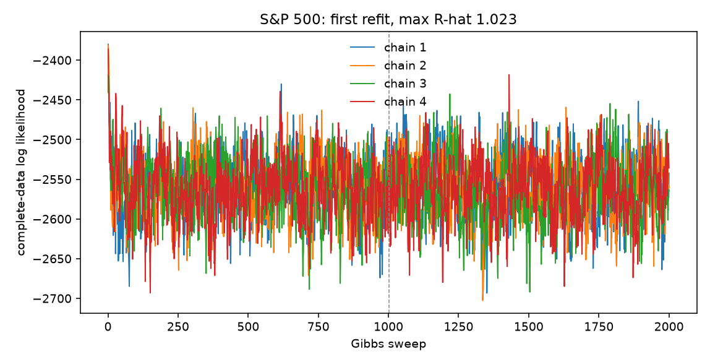
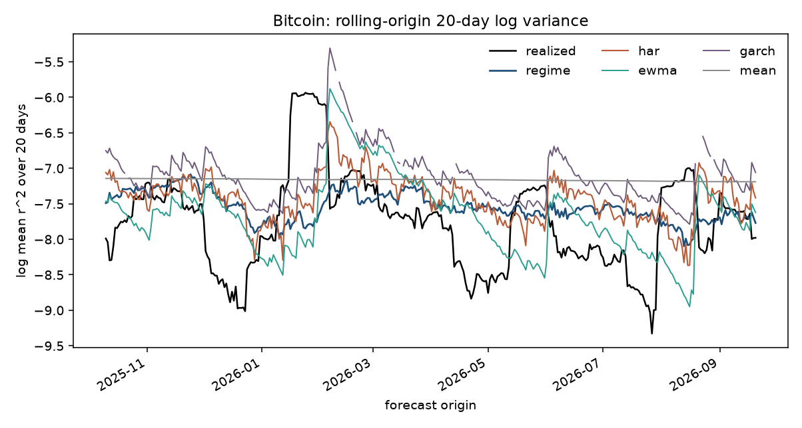
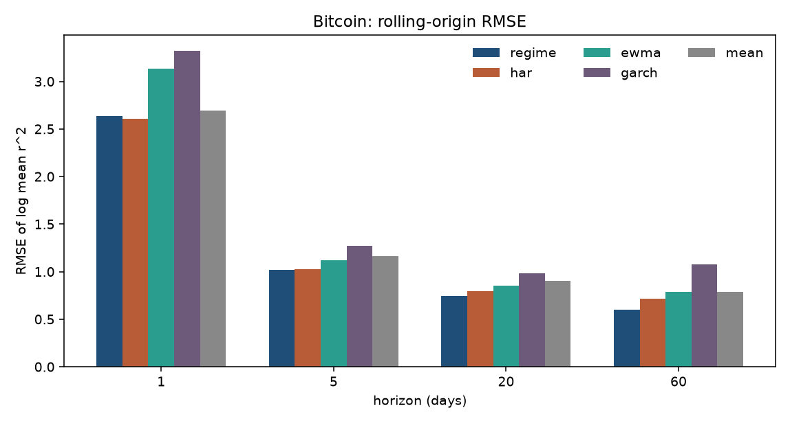
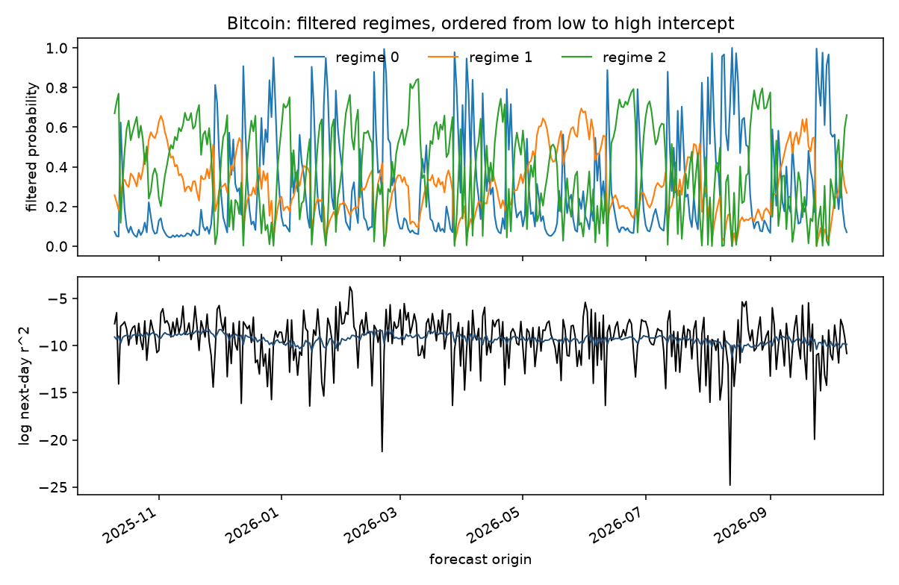
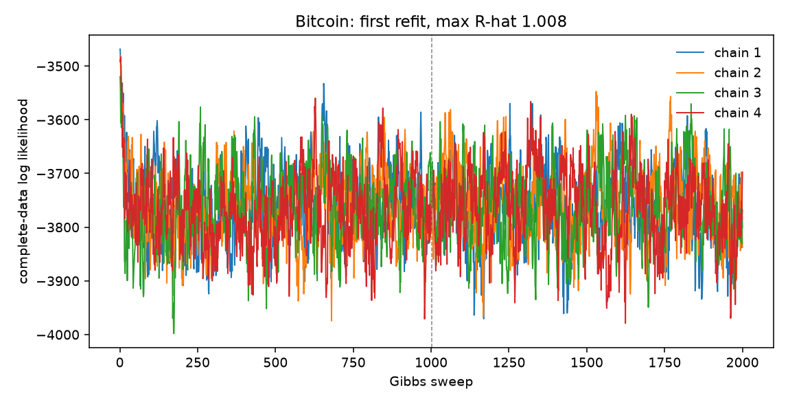

# Volatility forecast

The rolling-origin score below is the log of the mean squared return over the next 1, 5, 20, and 60 days. The earlier single-origin comparison, which used an overlapping realized-volatility target, is kept further down.

## Rolling origin

`examples/regime_volatility.py` scores every origin in the holdout. The S&P 500 holdout is the last 250 trading days. Bitcoin's is the last 365 calendar days. A horizon is kept only when the whole window sits inside the sample, so the 60-day score has fewer origins. The loss is squared error on that log mean. Diebold-Mariano statistics use a Newey-West variance with the Bartlett kernel and `h - 1` lags. A negative statistic means the regime model has the smaller loss. The p-value is two-sided normal.

Four baselines are fit only on data before the target window. HAR(1/5/22) is an ordinary least-squares regression of the log-mean target on an intercept, log daily variance, and the log of the 5-day and 22-day mean variance. The long-run mean is the average of those same completed targets. EWMA with decay 0.94 is reported as the log of its flat variance forecast. GARCH(1,1) with Student-t errors, fit with `arch` on the returns up to the origin, is reported as the log of the mean analytic variance over the horizon.

The regime model is a 3-state Markov-switching HAR on daily `log(r^2)`, not the sticky HDP-SLDS. The Gibbs step still uses one shared HAR slope, with a separate intercept and innovation scale in each regime. Draws whose companion spectral radius is 0.999 or higher are rejected. The Dirichlet prior on each transition row has mean self-stay 0.98 (`alpha = 1`, `kappa = 97`). That sampler is only there to produce regime probabilities and a transition matrix.

The scored forecast does not simulate a path. For each horizon, each retained draw gets its own direct regression of `log(mean r^2)` over the next `h` days on an intercept and three lags of daily `log(r^2)`: the previous day, the mean of the previous 5, and the mean of the previous 22. Each regime has its own intercept and its own three slopes. An origin is weighted by the average of the filtered distribution after 1 through `h` steps of that draw's transition matrix. A regime whose weights sum to less than 30 uses the pooled regression. The reported forecast is the average, over draws, of that weighted prediction minus the draw's mean residual. The residual is computed only on origins whose `h`-day window has already ended, so the correction never sees the origin being scored. Nothing is exponentiated.

Parameters are refit every 21 origins on a trailing 4-year window: 1008 trading days for the S&P 500 and 1460 calendar days for bitcoin. Each refit is 4 chains of 2000 sweeps from seed 23. Forecasts use 40 evenly spaced draws from the second half of each chain, 160 draws in total. The sweep count was raised until the worst refit on both holdouts had R-hat below 1.1. Nothing in the prior, the window, or the refit schedule was chosen on the holdout.

The "Simulated" column is the previous forecast, kept for comparison and not re-estimated. That run drew 25 Gaussian paths per retained draw, exponentiated them, and averaged `log(mean r^2)`. It used 3 chains of 500 sweeps. Its HAR, EWMA, and mean columns match the tables below at three decimals. Its GARCH column had 10 Bitcoin failures; this run has 9, so the GARCH numbers below are this run's.

Exact zero returns, five in the S&P file and one in the Bitcoin file, are replaced in `log(r^2)` by the smallest positive square in the estimation sample.

```bash
uv run python examples/regime_volatility.py sp500
uv run python examples/regime_volatility.py btc
```

### S&P 500





The run took 312.5 s. GARCH converged at every origin. The worst refit had R-hat 1.023. Every refit is between 1.004 and 1.023.

RMSE of log mean squared return. Direct is this run. Simulated is the previous path forecast. The lowest value on a row is the winner.

| Lead (days) | Origins | Direct | Simulated | HAR | EWMA 0.94 | GARCH-t | Mean |
| --- | ---: | ---: | ---: | ---: | ---: | ---: | ---: |
| 1 | 250 | 2.708 | 2.750 | 2.706 | 3.097 | 3.152 | 2.696 |
| 5 | 246 | 0.855 | 0.891 | 0.820 | 0.856 | 0.901 | 0.807 |
| 20 | 231 | 0.567 | 0.850 | 0.549 | 0.568 | 0.618 | 0.480 |
| 60 | 191 | 0.393 | 0.992 | 0.419 | 0.450 | 0.516 | 0.307 |

Diebold-Mariano statistic of the direct regime model against each baseline, with the two-sided p-value in parentheses. The simulated column is not in this test.

| Lead (days) | vs HAR | vs mean | vs EWMA | vs GARCH |
| --- | ---: | ---: | ---: | ---: |
| 1 | 0.14 (0.889) | 0.61 (0.541) | -4.61 (4.0e-6) | -4.88 (1.0e-6) |
| 5 | 1.09 (0.277) | 1.21 (0.225) | -0.04 (0.965) | -1.17 (0.241) |
| 20 | 0.50 (0.617) | 2.39 (0.017) | -0.01 (0.990) | -1.26 (0.209) |
| 60 | -0.86 (0.389) | 1.89 (0.058) | -1.18 (0.239) | -1.57 (0.115) |

The long-run mean still has the lowest RMSE at every horizon. The direct forecast is not distinguishable from HAR at any lead. At 60 days its RMSE is below HAR, EWMA, and GARCH, and the gap against the mean is not significant at 5%. It beats one-day EWMA and GARCH. The mean error is +0.102, +0.107, +0.101, and +0.152 at leads 1, 5, 20, and 60. The simulated forecast's errors on those same leads were +0.103, +0.298, +0.650, and +0.929, and that gap grew with the horizon. EWMA's mean error still goes from +1.519 at one day to +0.001 at 60 days, because a one-day EWMA or GARCH number is the log of a variance and the target is the log of a squared return.



On the first refit the posterior mean self-stay is 0.813, 0.953, and 0.896, so the implied runs last 5.3, 21.2, and 9.6 days. The prior mean was 0.98. Later refits stay in that neighborhood: the average self-stay across the three regimes drifts from 0.887 to 0.864. Ordered intercepts on the first refit are -5.804, -4.315, and -3.217, with shares 0.248, 0.274, and 0.477. The shared daily slopes are -0.103, 0.084, and 0.633, and the companion radius is 0.962. Every regression draw met the radius constraint. The second-half complete-data log likelihood on that refit has mean -2560 and standard deviation 38.



### Bitcoin





The run took 651.1 s. GARCH did not converge at 9 origins. Those origins are omitted from the GARCH RMSE and from the DM test against GARCH, and they stay in the other columns. The worst refit had R-hat 1.079. The other seventeen refits are between 1.008 and 1.056.

| Lead (days) | Origins | Direct | Simulated | HAR | EWMA 0.94 | GARCH-t | Mean |
| --- | ---: | ---: | ---: | ---: | ---: | ---: | ---: |
| 1 | 365 | 2.638 | 2.673 | 2.610 | 3.133 | 3.323 | 2.691 |
| 5 | 361 | 1.022 | 1.109 | 1.022 | 1.121 | 1.274 | 1.162 |
| 20 | 346 | 0.742 | 0.998 | 0.797 | 0.849 | 0.985 | 0.900 |
| 60 | 306 | 0.598 | 0.983 | 0.718 | 0.791 | 1.074 | 0.785 |

| Lead (days) | vs HAR | vs mean | vs EWMA | vs GARCH |
| --- | ---: | ---: | ---: | ---: |
| 1 | 1.23 (0.217) | -1.43 (0.153) | -6.19 (5.9e-10) | -7.22 (5.3e-13) |
| 5 | -0.01 (0.989) | -2.46 (0.014) | -2.09 (0.036) | -3.57 (3.6e-4) |
| 20 | -1.54 (0.123) | -1.96 (0.049) | -1.51 (0.130) | -3.51 (4.4e-4) |
| 60 | -1.78 (0.075) | -1.46 (0.145) | -1.43 (0.153) | -3.46 (5.3e-4) |

HAR has the lowest one-day RMSE. From five days on the direct forecast is tied with HAR or ahead of it on RMSE, and at 20 and 60 days it is the lowest of the six columns. The five-day tie with HAR is exact at three decimals (DM -0.01, p = 0.989). The 20-day and 60-day gaps against HAR are not significant at 5% (p = 0.123 and 0.075). The direct forecast does beat the mean at 5 and 20 days, EWMA at 1 and 5 days, and GARCH at every horizon. Its mean error is +0.102, +0.175, +0.210, and +0.225. The simulated forecast's errors were +0.099, +0.327, +0.627, and +0.805.



The first refit's posterior self-stay is 0.848, 0.958, and 0.902, with implied runs of 6.6, 23.8, and 10.3 days. Ordered intercepts are -5.878, -4.262, and -3.331, with shares 0.219, 0.426, and 0.355. The shared daily slopes are 0.048, -0.205, and 0.687, and the companion radius is 0.957. The second-half log likelihood has mean -3759 and standard deviation 69. The average self-stay drifts from 0.903 on the first refit to 0.875 on the last.



### Where this still loses

The direct regression removes the horizon-growing bias of the simulated path. What remains is smaller. Daily `log(r^2)` is still a noisy series: the one-day RMSE is about 2.6 to 2.7, and the posterior self-stay settles near 0.86 to 0.90 rather than the prior mean of 0.98, so a typical run is days to a few weeks. On the S&P 500 the long-run mean wins every horizon, and the direct model is not separable from HAR. On bitcoin the direct model has the best point forecast at 20 and 60 days, the win over GARCH is clear, and the win over HAR is not significant at 5%. A positive mean error of about 0.10 on the S&P 500 and 0.10 to 0.22 on bitcoin is still there after the training-window correction.

A separate check, with one HAR fit on lags 5, 22, and 66 before the holdout and an EWMA bias correction fit on that same training span, matches the rolling-origin note supplied with the data: S&P 500 lead 20 is EWMA 0.562, HAR 0.522, mean 0.481, and lead 60 is 0.451, 0.375, 0.310. Bitcoin lead 20 is 0.845, 0.762, 0.910, and lead 60 is 0.789, 0.684, 0.792. The tables above are the stricter protocol: HAR(1/5/22) refit at each origin, and EWMA and GARCH with no additive correction.

## Earlier single-origin score

Both series are daily closes. The target is the log of a trailing realized volatility, the root mean square of recent daily log returns. The S&P 500 uses a 20-trading-day window. Bitcoin trades every calendar day, including weekends, so its log returns are on a 7-day calendar and the window is 30 days. The figures show that forecast twice: as the log, and as an annualized volatility in percent, `100 * exp(log rv) * sqrt(days)`, with `days` 252 for the S&P 500 and 365 for bitcoin. The band is the central 90% of the posterior predictive draws. The held-out path is the realized value.

Three baselines never see the holdout. Trailing volatility holds the last training window flat. EWMA with decay 0.94 (the RiskMetrics benchmark) is updated on training returns and then held at its last variance forecast. GARCH(1,1) with Student-t errors is fit with `arch` on the training returns only. For each holdout day the root mean square uses realized squared returns inside the training sample and the variance forecast after that. The window in that average is the same window as the target: 20 days for the S&P 500 and 30 days for bitcoin. On the S&P 500 the first 19 holdout windows still contain known returns, so leads 1 and 5 are not fully out of sample and leads 20 and 60 are. On bitcoin the first 29 windows still contain known returns, so leads 1, 5, and 20 are not fully out of sample and lead 60 is.

The score is the RMSE of log realized volatility through the first 1, 5, 20, and 60 holdout days, and through the whole holdout (250 trading days, or 365 calendar days). One series means the 1-day number is a single absolute error. Nothing here was chosen on the holdout.

The return stays in the model as the second observation. On both series that forecast is close to unpredictable: it does not beat predicting zero.

```bash
uv run python examples/volatility_forecast.py sp500
uv run python examples/volatility_forecast.py btc
```

Each script accepts a sweep count as its only argument. The default is 300.

## S&P 500


The snapshot `examples/data/sp500_daily.csv` is the Yahoo Finance chart API `^GSPC` daily close, interval 1d, downloaded 2026-10-11. The source and that date are in `examples/data/README.md`. The file runs from 1990-01-02 through 2026-10-09 (9261 rows). The only gap longer than five days is the market closure from 2001-09-10 to 2001-09-17, and that closure is kept. After the 20-day window the fit uses every remaining observation before the holdout, 1990-01-30 through 2025-10-10 (8991 days), and holds out 2025-10-13 through 2026-10-09 (250 trading days). That training window was long enough to finish, so it was not cut shorter. The run took 681.4 s.

RMSE of log 20-day realized volatility:

| Lead (days) | SLDS | Trailing 20-day | EWMA 0.94 | GARCH-t | Lowest RMSE |
| --- | ---: | ---: | ---: | ---: | --- |
| 1 | 0.068 | 0.094 | 0.074 | 0.059 | GARCH |
| 5 | 0.072 | 0.101 | 0.041 | 0.044 | EWMA |
| 20 | 0.145 | 0.178 | 0.041 | 0.150 | EWMA |
| 60 | 0.180 | 0.181 | 0.163 | 0.350 | EWMA |
| 250 | 0.229 | 0.228 | 0.217 | 0.487 | EWMA |

GARCH wins day 1 (0.059). That day still has 19 known returns in the window, so the score is mostly a one-step variance forecast. From lead 5 on, EWMA wins, and at lead 20, the first window with no training returns, EWMA (0.041) is well ahead of GARCH (0.150) and the SLDS (0.145). The SLDS does not win a lead. Over 250 days EWMA is 0.217, the trailing value is 0.228, the SLDS is 0.229, and GARCH is 0.487.

The SLDS 90% band covers every holdout day. The GARCH 90% band, the 5th to 95th percentile of 2000 simulated paths, also covers every holdout day. Both bands are wide. The GARCH fit has alpha 0.098, beta 0.897, persistence 0.994, and Student-t degrees of freedom 6.38.

The return RMSE is 0.711 against 0.704 for predicting zero.


Labels in that figure are the last sweep, sorted so mode 0 has the lowest mean log volatility. Mean annualized volatility in those five slices is about 11%, 11%, 12%, 23%, and 26%. The two slices near 11% cover 24% and 38% of the training days. The 12% slice covers 3%, so the calm cluster is about 65% of the sample. The 23% slice covers 25% and the 26% slice covers 11%. The annualized averages rise with the log-volatility sort on this draw. What separates is a calm band near 11% and an elevated band near 23–26%, including the early 1990s and the 2008 and 2020 declines. That is a coarse calm-versus-turbulent split, and five occupied modes means the truncation is full. Every sweep in the second half occupies all 5 modes. The log joint over sweeps 151–300 has mean 17545, standard deviation 267, and slope -3.23 per sweep. That slope is a small fraction of the sweep-to-sweep scatter.


## Bitcoin


The snapshot `examples/data/btc_daily.csv` is the Yahoo Finance chart API `BTC-USD` daily close, interval 1d, downloaded 2026-10-11. The download ran through 2026-10-11. That last row is the download date, so it is dropped as an incomplete session. The file kept here has a close on every calendar day from 2014-09-17 through 2026-10-10 (4407 rows). After the 30-day window the fit uses every remaining observation before the holdout, 2014-10-17 through 2025-10-10 (4012 days), and holds out 2025-10-11 through 2026-10-10 (365 days). The same prior and seed as the S&P 500 are used. Nothing was retuned, and the training window was not cut shorter. The run took 296.0 s.

RMSE of log 30-day realized volatility. Leads 1, 5, and 20 still contain known training returns. Lead 60 does not.

| Lead (days) | SLDS | Trailing 30-day | EWMA 0.94 | GARCH-t | Lowest RMSE |
| --- | ---: | ---: | ---: | ---: | --- |
| 1 | 0.012 | 0.011 | 0.004 | 0.021 | EWMA |
| 5 | 0.055 | 0.069 | 0.014 | 0.047 | EWMA |
| 20 | 0.069 | 0.106 | 0.075 | 0.219 | SLDS |
| 60 | 0.074 | 0.150 | 0.094 | 0.421 | SLDS |
| 365 | 0.409 | 0.300 | 0.316 | 1.116 | trailing |

EWMA wins day 1 (0.004) and lead 5 (0.014). The SLDS wins lead 20 (0.069) and lead 60 (0.074). Lead 60 is the first of these horizons whose 30-day window contains no training returns, and there the SLDS beats EWMA (0.094), the trailing value (0.150), and GARCH (0.421). Over all 365 days the trailing 30-day value wins (0.300), ahead of EWMA (0.316) and the SLDS (0.409). GARCH is the worst of the four on that full window (1.116). Its persistence rounds to 1, so the variance forecast barely mean-reverts. The GARCH fit has alpha 0.107, beta 0.893, and Student-t degrees of freedom 3.18.

Both 90% bands cover every one of the first 60 holdout days. Over all 365 days the SLDS band covers 85.5% and the GARCH band covers 98.4%. The GARCH coverage is high because the band is wide: read it next to the RMSE of 1.116.

The return RMSE is 0.670 against 0.657 for predicting zero.


The same last-sweep ordering, now in `sqrt(365)` units, gives mean annualized volatilities of about 34%, 44%, 46%, 67%, and 80%. The 44% slice covers 59% of training days. The 46% slice covers 12%, and the 80% slice covers 20%. The 34% and 67% slices are thin, at 6% and 3%. Relative to bitcoin's own history that is a calm-versus-turbulent split. The 2020–2022 stretch and the late-2024 rise sit in the high slices. Every sweep in the second half occupies all 5 modes. Earlier sweeps sometimes used 4. Sweeps 151–300 have log-joint mean 9360, standard deviation 142, and slope -0.57 per sweep. That slope is small next to the scatter.


## How the series is built

Daily closes are not the observations. A price level trends, so a linear dynamical mode spends its capacity on that drift. The return is `r_t = log(P_t / P_{t-1})`. On the S&P 500 those returns fall on trading days, and the 2001-09-17 return is the move from the 2001-09-10 close across the closure. On bitcoin the file has a close every calendar day, so the return is from one calendar day to the next. The volatility channel is the log of the root mean square over the dataset's window. Each channel is standardized with the mean and standard deviation of the training window only.

The model is a sticky HDP-SLDS with truncation 5, identity emission, and a weakly informative matrix-normal prior whose mean says a return is unpredictable and log volatility is persistent. Column precision is the identity, so the sample dominates. The sticky prior has mean `alpha + kappa = 8`, mean `rho = 0.8`, and mean `gamma = 2`. `gibbs_step` runs 300 sweeps from seed 23. Forecasts are draws from the second half of the chain, after the Gibbs loop.

## How the GARCH forecast is converted

`arch` fits a zero-mean GARCH(1,1) with Student-t errors (`dist="t"`, `rescale=True`). Rescaling multiplies the returns by 100. Reported `omega` and the variance forecasts are divided by `100**2` so they are back in return units. `alpha`, `beta`, and `nu` are unchanged by that scale.

The analytic variance of the return `h` days after the last training return follows

`v_1 = omega + alpha * r_T^2 + beta * sigma_T^2`

`v_h = omega + (alpha + beta) * v_{h-1}`

When `alpha + beta` is strictly below 1, that is the same path as the closed form that mean-reverts to `omega / (1 - alpha - beta)`. `arch`'s analytic forecast matches this recursion in original units. On bitcoin the fitted persistence rounds to 1, so `v_h` barely moves, and the long-horizon score shows that.

The point forecast of the SLDS target keeps realized squares for any day in the window that is still inside the training sample, puts `v_h` in for each later day, and takes the log of the root mean square. The window is 20 trading days for the S&P 500 and 30 calendar days for bitcoin, the same window as the fitted target. It is not the average of the log.

The 90% band draws 2000 paths from the same fit, seed 23. Each shock is a Student-t draw divided by `sqrt(nu / (nu - 2))`, so it has variance 1, which is the shock the GARCH recursion expects. Each path is converted with the same mix of known squares and simulated squares. The band is the 5th and 95th percentiles. Coverage is the share of realized holdout log-volatility values inside that band.

## Limits

One series is not a panel, so a coverage rate is a single path and moves around. Mode labels are the last sweep, ordered by mean log volatility for that draw only. They are not aligned across sweeps. The 90% band can cover the holdout by being wide. Read it next to the RMSE. Trailing volatility and EWMA are point forecasts, not bands. The GARCH band is a simulated percentile, and it can be wide too. A linear mode fitted on past returns is not a trading rule, and these runs were not asked to beat a market.
