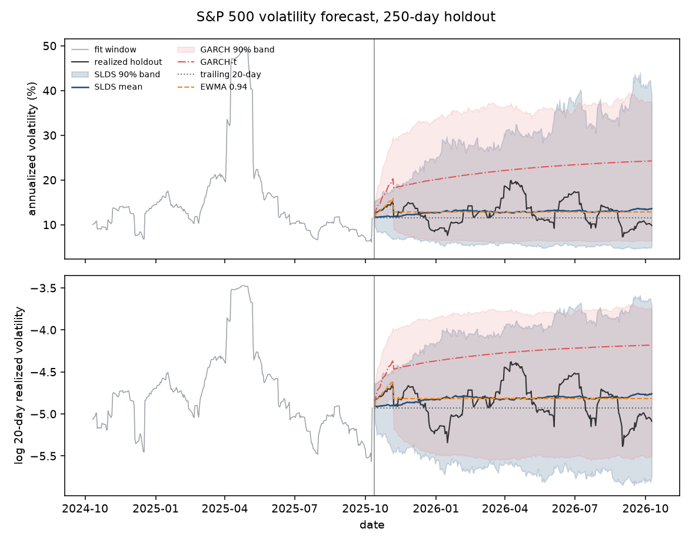
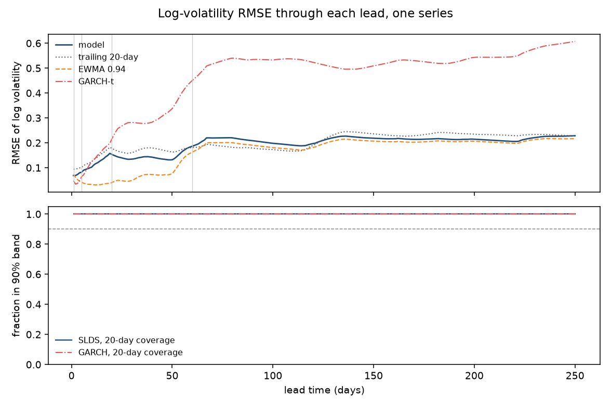
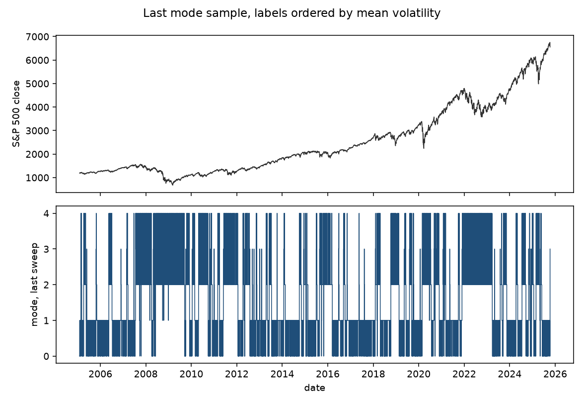
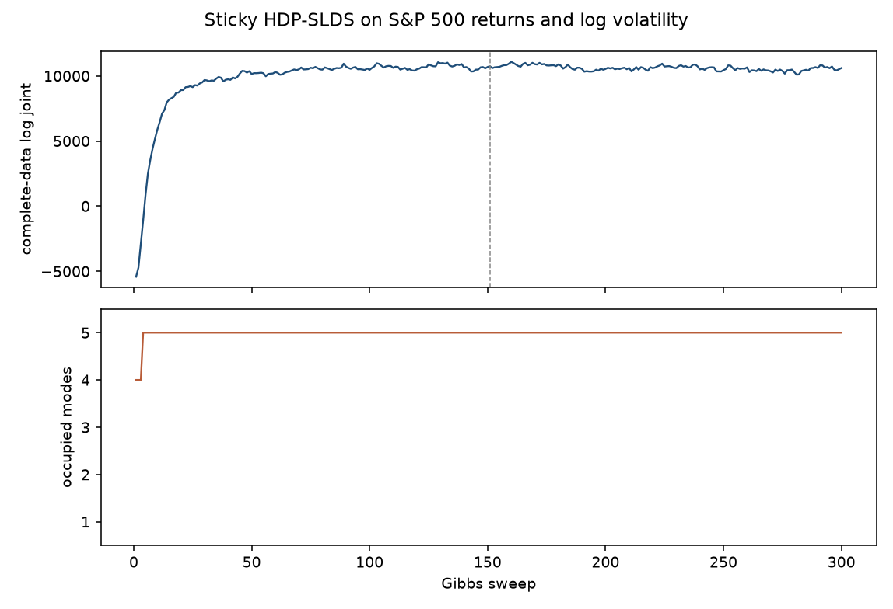
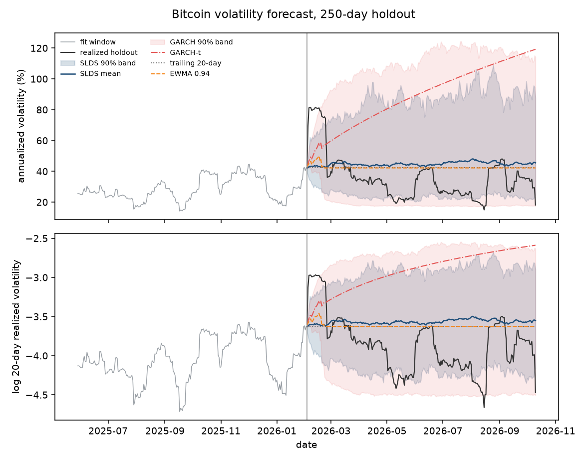
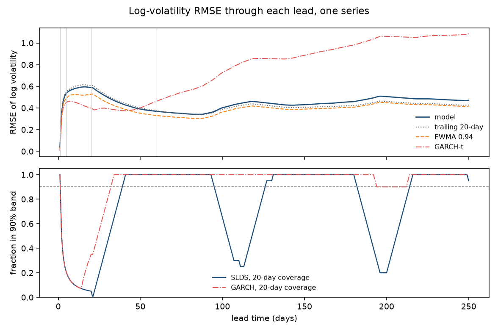
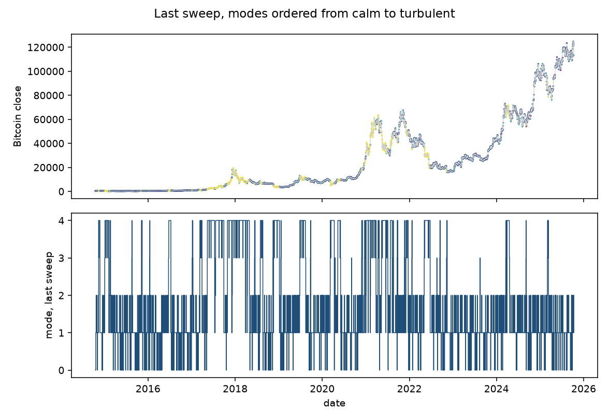
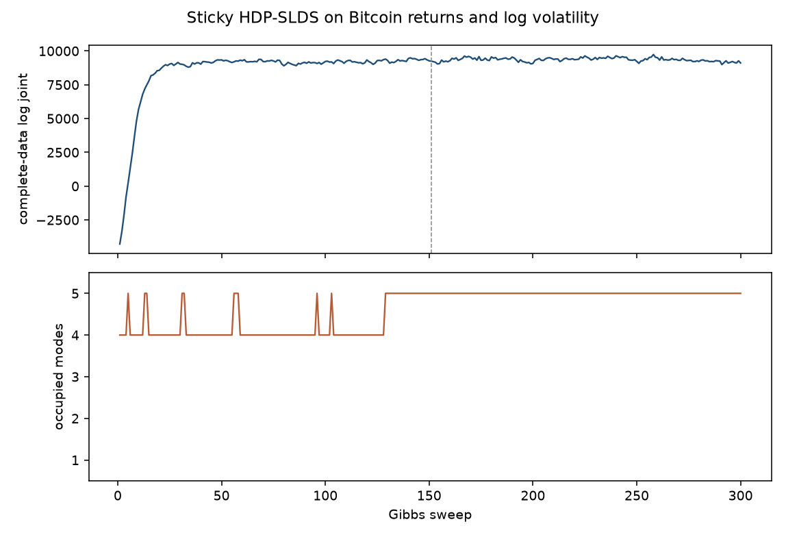

# Volatility forecast

The target is the log of 20-day realized volatility. Realized volatility is the root mean square of the last 20 daily log returns. The figures show that forecast twice: as the log, and as the annualized volatility in percent, `100 * exp(log rv) * sqrt(252)`. The band is the central 90% of the posterior predictive draws. The held-out path is the realized value.

Three baselines never see the holdout. Trailing volatility holds the last training 20-day value flat. EWMA with decay 0.94 (the RiskMetrics benchmark) is updated on training returns and then held at its last variance forecast. GARCH(1,1) with Student-t errors is fit with `arch` on the training returns only. For each holdout day the 20-day root mean square uses realized squared returns inside the training window and the variance forecast after that. The first 19 holdout windows still contain known returns, so leads 1 and 5 are not fully out of sample. Leads 20 and 60 are.

The score is the RMSE of log realized volatility through the first 1, 5, 20, and 60 holdout days, and through all 250. One series means the 1-day number is a single absolute error. Nothing here was chosen on the holdout.

The return stays in the model as the second observation. On both series that forecast is close to unpredictable: it does not beat predicting zero.

```bash
uv run python examples/sp500_forecast.py
uv run python examples/btc_forecast.py
```

Each script accepts a sweep count as its only argument. The default is 300.

## S&P 500





The snapshot `examples/data/sp500_daily.csv` is the Yahoo Finance `^GSPC` daily close, downloaded 2026-10-11. The fit uses 2005-02-01 through 2025-10-10 (5207 days) and holds out 2025-10-13 through 2026-10-09 (250 trading days). The run took 387.5 s.

RMSE of log 20-day realized volatility:

| Lead (days) | SLDS | Trailing 20-day | EWMA 0.94 | GARCH-t | Lowest RMSE |
| --- | ---: | ---: | ---: | ---: | --- |
| 1 | 0.069 | 0.094 | 0.074 | 0.048 | GARCH |
| 5 | 0.082 | 0.101 | 0.041 | 0.064 | EWMA |
| 20 | 0.154 | 0.178 | 0.041 | 0.215 | EWMA |
| 60 | 0.186 | 0.181 | 0.163 | 0.451 | EWMA |
| 250 | 0.228 | 0.228 | 0.217 | 0.608 | EWMA |

GARCH wins day 1 (0.048). That day still has 19 known returns in the window, so the score is mostly a one-step variance forecast. From lead 5 on, EWMA wins, and at lead 20, the first window with no training returns, EWMA (0.041) is well ahead of GARCH (0.215) and the SLDS (0.154). The SLDS does not win a lead. Over 250 days EWMA is 0.217, the SLDS and the trailing value tie at 0.228, and GARCH is 0.608.

The SLDS 90% band covers every holdout day. The GARCH 90% band, the 5th to 95th percentile of 2000 simulated paths, also covers every holdout day. Both bands are wide. The GARCH fit has alpha 0.130, beta 0.864, persistence 0.993, and Student-t degrees of freedom 5.83.

The return RMSE is 0.667 against 0.661 for predicting zero.



Labels in that figure are the last sweep, sorted so mode 0 has the lowest mean log volatility. Mean annualized volatility in those five slices is about 10%, 10%, 22%, 27%, and 23%. The two calm slices cover 18% and 37% of the training days. The 27% slice covers 3%. The annualized averages are not strictly increasing, because the sort is on mean log-volatility and a short slice can have a higher average after the exponential. What separates is a calm band near 10% and an elevated band near 23%, including the 2008 and 2020 declines. That is a coarse calm-versus-turbulent split, not five regimes. Every sweep in the second half occupies all 5 modes, so the truncation is full. The log joint over sweeps 151–300 has mean 10609, standard deviation 192, and slope -2.26 per sweep.



## Bitcoin





The snapshot `examples/data/btc_daily.csv` is the Yahoo Finance `BTC-USD` daily close, downloaded the same day. It includes weekends. The fit uses 2014-10-06 through 2026-02-02 (4138 days) and holds out 2026-02-03 through 2026-10-10 (250 days). The same prior and seed are used. Nothing was retuned. The run took 306.3 s.

RMSE of log 20-day realized volatility:

| Lead (days) | SLDS | Trailing 20-day | EWMA 0.94 | GARCH-t | Lowest RMSE |
| --- | ---: | ---: | ---: | ---: | --- |
| 1 | 0.037 | 0.035 | 0.018 | 0.004 | GARCH |
| 5 | 0.539 | 0.553 | 0.490 | 0.451 | GARCH |
| 20 | 0.589 | 0.608 | 0.527 | 0.396 | GARCH |
| 60 | 0.369 | 0.374 | 0.330 | 0.463 | EWMA |
| 250 | 0.472 | 0.428 | 0.418 | 1.086 | EWMA |

GARCH wins leads 1, 5, and 20, including the first window that contains no training returns (0.396 against 0.527 for EWMA and 0.589 for the SLDS). EWMA wins lead 60 and the full 250 days. GARCH's 250-day RMSE is 1.086, the worst of the four, because the fitted persistence is 1.000 and the variance forecast barely mean-reverts. The SLDS does not win a lead. It is behind both the trailing value and EWMA over 250 days (0.472 against 0.428 and 0.418).

The SLDS 90% band covers the first day, then 20% of the first 5 days and 5% of the first 20. Through 60 days that coverage is 66.7%, and over the full holdout it is 79.2%. The GARCH band covers the first day, 20% of the first 5, 35% of the first 20, 78.3% of the first 60, and 94.0% of the holdout. The GARCH fit has alpha 0.108, beta 0.892, and Student-t degrees of freedom 3.19.

The return RMSE is 0.685 against 0.680 for predicting zero.



The same last-sweep ordering gives mean annualized volatilities of about 29%, 42%, 44%, 60%, and 83%. The 42% slice covers 55% of training days. The 83% slice covers 17%, and it is where the 2018 and 2022 drawdowns sit. The 29% and 60% slices are thin, about 5% each. Relative to bitcoin's own history the ends of that range are calm and turbulent. The second half of the chain again occupies all 5 modes. The log joint is still climbing at sweep 300: sweeps 151–300 have mean 8644, standard deviation 230, and slope +4.26 per sweep. The chain has not settled.



## How the series is built

Daily closes are not the observations. A price level trends, so a linear dynamical mode spends its capacity on that drift. The return is `r_t = log(P_t / P_{t-1})`. The volatility channel is `log` of the 20-day root mean square of those returns. Each channel is standardized with the mean and standard deviation of the training window only.

The model is a sticky HDP-SLDS with truncation 5, identity emission, and a weakly informative matrix-normal prior whose mean says a return is unpredictable and log volatility is persistent. Column precision is the identity, so the sample dominates. The sticky prior has mean `alpha + kappa = 8`, mean `rho = 0.8`, and mean `gamma = 2`. `gibbs_step` runs 300 sweeps from seed 23. Forecasts are draws from the second half of the chain, after the Gibbs loop.

## How the GARCH forecast is converted

`arch` fits a zero-mean GARCH(1,1) with Student-t errors (`dist="t"`, `rescale=True`). Rescaling multiplies the returns by 100. Reported `omega` and the variance forecasts are divided by `100**2` so they are back in return units. `alpha`, `beta`, and `nu` are unchanged by that scale.

The analytic variance of the return `h` days after the last training return follows

`v_1 = omega + alpha * r_T^2 + beta * sigma_T^2`

`v_h = omega + (alpha + beta) * v_{h-1}`

When `alpha + beta` is strictly below 1, that is the same path as the closed form that mean-reverts to `omega / (1 - alpha - beta)`. `arch`'s analytic forecast matches this recursion in original units. On bitcoin the fitted persistence rounds to 1, so `v_h` barely moves, and the long-horizon score shows that.

The point forecast of the SLDS target keeps realized squares for any day in the 20-day window that is still inside the training sample, puts `v_h` in for each later day, and takes the log of the root mean square of those 20 values. It is not the average of the log.

The 90% band draws 2000 paths from the same fit, seed 23. Each shock is a Student-t draw divided by `sqrt(nu / (nu - 2))`, so it has variance 1, which is the shock the GARCH recursion expects. Each path is converted with the same mix of known squares and simulated squares. The band is the 5th and 95th percentiles. Coverage is the share of realized holdout log-volatility values inside that band.

## Limits

One series is not a panel, so a coverage rate is a single path and moves around. Mode labels are the last sweep, ordered by mean log volatility for that draw only. They are not aligned across sweeps. The 90% band can cover the holdout by being wide. Read it next to the RMSE. Trailing volatility and EWMA are point forecasts, not bands. The GARCH band is a simulated percentile, and it can be wide too. A linear mode fitted on past returns is not a trading rule, and these runs were not asked to beat a market.
